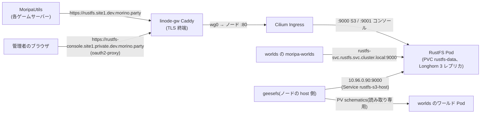

site1 に S3 互換のオブジェクトストレージ **RustFS** を 1 台(standalone)置く。最初の利用者は
MoripaUtils(プレイヤーが上げた schematic の保存先)と worlds(schematic からワールドを作る仕組み)。
外部の S3(R2 等)を使わないのは、転送量・鍵の管理を自前で閉じ、クラスタ内からは LAN 内で読めるようにするため。

| 置き場所 | 中身 |
|---|---|
| `bootstrap/applications/rustfs.yaml` | ArgoCD の `rustfs` Application(chart `charts.rustfs.com` の `rustfs`、wave 1、prune 無効) |
| `infrastructure/rustfs/values.yaml` | standalone、Longhorn 50Gi、Recreate、ログは stdout |
| `infrastructure/rustfs/ingress.yaml` | S3(公開)とコンソール(private)の Ingress |
| `infrastructure/rustfs/service-host.yaml` | csi-s3 用の固定 ClusterIP `10.96.0.90` の Service |
| `infrastructure/rustfs/provision.yaml` | バケット / IAM ユーザー / ポリシーを入れる PostSync Job |
| `infrastructure/rustfs/secrets.sops.yaml` | root の鍵(`rustfs-root`)、IAM ユーザーのシークレット(`rustfs-provision`) |
| `bootstrap/applications/csi-s3.yaml` + `infrastructure/csi-s3/` | csi-s3 ドライバ、静的 PV / PVC `schematics`、namespace `worlds`、接続先 Secret |

(パスはいずれも `kubernetes/sites/site1/` 以下。chart のバージョンは `ansible/group_vars/all/versions.yml` の
`rustfs_chart_version` / `csi_s3_version` と一致させる。`make check-consistency` が検査する)

## 構成と経路



| 用途 | 接続先 |
|---|---|
| S3 API(外部・ゲームサーバー) | `https://rustfs.site1.dev.morino.party`(path-style、region `us-east-1`) |
| S3 API(クラスタ内) | `http://rustfs-svc.rustfs.svc.cluster.local:9000` |
| S3 API(ノードの host 側、csi-s3 専用) | `http://10.96.0.90:9000` |
| 管理コンソール | `https://rustfs-console.site1.private.dev.morino.party/rustfs/console/`(oauth2-proxy の後、RustFS 自身のログイン) |

- 冗長化は Longhorn(3 レプリカ)に任せ、RustFS の erasure coding(distributed モード)は使わない。
  Longhorn の RWO ボリュームなので Deployment は `Recreate`(更新時に数十秒止まる)
- 公開ホスト名は既存の `*.site1.dev` / `*.site1.private.dev` のワイルドカード(DNS・Caddyfile)に乗るので、
  DNS や Caddy の変更は要らない
- root の鍵は管理用。アプリには必ず下の IAM ユーザーを渡す

## バケットと IAM ユーザー

バケットは `moripa-utils` の 1 つ。ユーザーとポリシーは `provision.yaml` の Job が ArgoCD の sync ごと
(PostSync)に入れ直す。各操作は冪等で、シークレットを差し替えて sync すればそのユーザーの鍵も
置き換わる。

| ユーザー(= アクセスキー ID) | シークレット(`rustfs-provision` のキー) | ポリシー | 権限 |
|---|---|---|---|
| `moripa-utils` | `UTILS_SK` | `moripa-utils-rw` | `moripa-utils/*` の Put / Get / Delete / multipart、バケットの List |
| `worlds` | `WORLDS_SK` | `worlds-schematics` | `moripa-utils/schematics/*` の Get / Delete、バケットの List |
| `csi-s3` | `CSI_SK` | `csi-s3-schematics-ro` | `moripa-utils/schematics/*` の Get、バケットの List |

worlds の Secret(`apps/worlds/secrets.sops.yaml`)は `AWS_ACCESS_KEY_ID=worlds`、
`AWS_SECRET_ACCESS_KEY=<WORLDS_SK>` と揃える。csi-s3 の Secret(`infrastructure/csi-s3/secrets.sops.yaml`)は
`accessKeyID=csi-s3`、`secretAccessKey=<CSI_SK>`。

### 鍵の確認・差し替え

```bash
# 見るだけ
sops -d kubernetes/sites/site1/infrastructure/rustfs/secrets.sops.yaml
# 編集(保存すると再暗号化される)
sops kubernetes/sites/site1/infrastructure/rustfs/secrets.sops.yaml
```

- キーは英数字だけで作る(Job が `http://<AK>:<SK>@...` の URL に埋めるため)。例: `LC_ALL=C tr -dc 'A-Za-z0-9' </dev/urandom | head -c 40`
- `CSI_SK` / `WORLDS_SK` を変えたら、csi-s3 / worlds の Secret も同じ値にして一緒に push する
- root の鍵(`RUSTFS_ACCESS_KEY` / `RUSTFS_SECRET_KEY`)を変えたら `kubectl -n rustfs rollout restart deploy/rustfs`
  (ArgoCD は Secret の変更で Pod を作り直さない)。Pod が新しい鍵で起動するまでプロビジョニング Job は
  失敗するので、再起動後に ArgoCD で `rustfs` をもう一度 sync して Job を流し直す

## MoripaUtils の設定

`config.conf` の `storage` に書く。path-style 以外の特別なクライアント設定は要らない
(AWS SDK v2 の PutObject、aws-chunked のストリーミング送信で動作確認済み)。

```txt
storage {
  endpoint = "https://rustfs.site1.dev.morino.party"
  region = us-east-1
  bucket = "moripa-utils"
  accessKeyId = "moripa-utils"
  secretAccessKey = "<UTILS_SK>"
  pathStyleAccess = true
}
```

## csi-s3(schematic の読み取り専用マウント)

worlds のワールド Pod は schematic を S3 API ではなくファイルとして読む。そのため
[k8s-csi-s3](https://github.com/yandex-cloud/k8s-csi-s3)(ドライバ `ru.yandex.s3.csi`)で
`moripa-utils/schematics/` を geesefs(FUSE)でマウントし、静的 PV / PVC `schematics`(namespace `worlds`、
`ReadOnlyMany`)として見せる。

- **geesefs は Pod ではなくノードの host 側**(systemd の transient unit)で動く。クラスタ DNS を引けないので、
  接続先は固定 ClusterIP `10.96.0.90`(Service `rustfs-s3-host`。Cilium の kube-proxy replacement で host
  からも届く)。`10.96.0.0/24` は静的割り当て用の帯で、使用中は `.1`(kubernetes)、`.10`(kube-dns)、`.90`
- マウントは `-o ro`、ファイル `0444` / ディレクトリ `0555`(ワールドの Pod は uid 10001 で読む)。
  書き込み・削除は S3 API(MoripaUtils / moripa-worlds)側でだけ行う
- S3 側の変更がマウントに見えるまで `--stat-cache-ttl 10s` ぶん(〜10 秒)遅れる
- **csi-s3 の chart を更新したら、マウントを使っている Pod(worlds のワールド)を再起動する**。ドライバの
  更新でマウントが切れたまま戻らないことがある(upstream issue
  [#179](https://github.com/yandex-cloud/k8s-csi-s3/issues/179) /
  [#156](https://github.com/yandex-cloud/k8s-csi-s3/issues/156))
- PVC の `storageClassName` は実在しない `csi-s3-static` で、PVC の `volumeName` で PV に結び付けている。
  省略すると既定の StorageClass(Longhorn)で新しいボリュームが作られてしまう。PV 側の `claimRef` は
  bind 時に PV コントローラが uid 付きで書くので、マニフェストには書かない(書くと Argo CD が永久に OutOfSync になる)
- namespace `worlds` は csi-s3 の Application(wave 1)が作る(`infrastructure/csi-s3/namespace-worlds.yaml`)。
  worlds の Application(wave 2)より先に PVC を置くため。worlds 側の `CreateNamespace=true` は
  「無ければ作る」だけなので併用してよい

## コンソール

`https://rustfs-console.site1.private.dev.morino.party/rustfs/console/` を開き、oauth2-proxy
(GitHub org / MineAuth staff)を通った後、RustFS のログイン画面で root の
`RUSTFS_ACCESS_KEY` / `RUSTFS_SECRET_KEY` を入れる。バケットの中身の確認やユーザーの状態確認に使う。
ユーザー・ポリシーの変更はコンソールではなく `provision.yaml` に書く(次の sync で上書きされるため)。

## バックアップ

データは PVC `rustfs-data`(Longhorn、3 レプリカ)だけ。Longhorn の UI / RecurringJob でスナップショットを
取れる(スナップショットはクラスタ外へは出ない。拠点ごと失うと消える)。schematic は MoripaUtils から
再アップロードできる前提で、現時点ではクラスタ外へのバックアップは取っていない。
PVC は chart の `helm.sh/resource-policy: keep` と Application の prune 無効で、誤って消えないようにしてある。

## 反映後の確認

```bash
# Pod / PVC / Job
kubectl -n rustfs get deploy,pod,pvc,svc,ingress
kubectl -n rustfs logs job/rustfs-provision   # PostSync の後すぐ消える(成功時)。失敗時は残る

# 公開経路で数 MB を往復(moripa-utils の鍵。バケット一覧の権限は無いのでバケットを指定する)
export AWS_ACCESS_KEY_ID=moripa-utils AWS_SECRET_ACCESS_KEY='<UTILS_SK>' AWS_DEFAULT_REGION=us-east-1
EP=https://rustfs.site1.dev.morino.party
head -c 8M /dev/urandom > /tmp/rustfs-test.bin
aws --endpoint-url $EP s3 cp /tmp/rustfs-test.bin s3://moripa-utils/schematics/rustfs-test.bin
aws --endpoint-url $EP s3 ls s3://moripa-utils/schematics/
aws --endpoint-url $EP s3 cp s3://moripa-utils/schematics/rustfs-test.bin /tmp/rustfs-test.out && cmp /tmp/rustfs-test.bin /tmp/rustfs-test.out

# csi-s3
kubectl -n csi-s3 get ds,sts,pod
kubectl get pv schematics
kubectl -n worlds get pvc schematics   # STATUS Bound

# PVC をマウントしたデバッグ Pod で見えること(〜10 秒の遅れ)と、書けないことを確認
kubectl -n worlds run schem-debug --rm -it --restart=Never --image=busybox:1.37.0 --overrides='
{"spec":{"securityContext":{"runAsUser":10001,"runAsGroup":10001},
 "containers":[{"name":"schem-debug","image":"busybox:1.37.0","stdin":true,"tty":true,
  "command":["sh"],"volumeMounts":[{"name":"s","mountPath":"/schematics","readOnly":true}]}],
 "volumes":[{"name":"s","persistentVolumeClaim":{"claimName":"schematics","readOnly":true}}]}}'
#   / $ ls -l /schematics && md5sum /schematics/rustfs-test.bin && touch /schematics/x   # touch は失敗するはず

# 後片付け
aws --endpoint-url $EP s3 rm s3://moripa-utils/schematics/rustfs-test.bin
```
