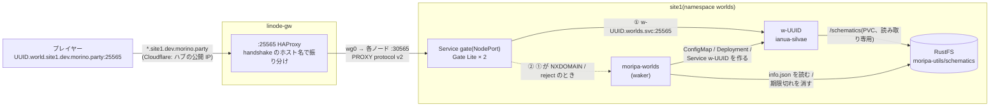

プレイヤーが MoripaUtils で上げた schematic(Sponge v3)を、そのまま 1 つのワールドとして遊べるようにする。
Minecraft のサーバー追加に **`<uuidv7>.world.site1.dev.morino.party`** を入れるだけで、
最初の接続(サーバーリストの ping でもよい)でワールドが起動し、誰もいなくなれば止まる。

`kubernetes/sites/site1/apps/worlds/` を ArgoCD の `worlds` Application(`apps` の配下)が同期する。

| コンポーネント | 置き場所 | 役割 |
|---|---|---|
| HAProxy(ハブ) | `ansible/group_vars/all/network.yml` の `minecraft_hosts_public` | `:25565` の handshake に `.world.site1.dev.morino.party` が含まれていれば、site1 の全ノードの NodePort `30565` へ PROXY protocol v2 付きで送る |
| `gate`(Deployment 2 台、Service `gate` NodePort `30565`) | `worlds/gate.yaml` | Minekube Gate の Lite モード。ホスト名から `<uuid>` を取り出し、`w-<uuid>` → `moripa-worlds` の順に繋ぐ |
| `moripa-worlds`(Deployment 1 台) | `worlds/moripa-worlds.yaml`(コードは github.com/morinoparty/moripa-worlds) | 起動係(waker)・片付け係(reaper)・期限切れ schematic の削除(sweeper)。`/metrics` は ServiceMonitor で Prometheus へ |
| `w-<uuid>`(ConfigMap / Deployment / Service) | git には無い。moripa-worlds が作って消す | ワールド本体。[ianua-silvae](https://github.com/morinoparty/ianua-silvae)(Minestom)が schematic を貼って待ち受ける |
| RustFS(S3)のバケット `moripa-utils` | `schematics/<uuid>/` | MoripaUtils が上げる本体(`info.json` の `file_name`)と `info.json` |
| PVC `schematics` | (別途) | csi-s3(geesefs)で `moripa-utils/schematics` を読み取り専用でワールドの Pod に見せる |
| NetworkPolicy | `worlds/networkpolicy.yaml` | Gate の egress、ワールドの ingress / egress を絞る(後述) |

## 経路



- Gate は接続ごとに backend を上から順に試し(`strategy: sequential`)、名前もそのたびに引き直す。
  ワールドが無ければ `w-<uuid>` の Service が無く NXDOMAIN、Pod が Ready でなければ Cilium が reject を返すので、
  待たずに ② の waker へ落ちる
- Gate → ワールド / waker には handshake を**書き換えずに**そのまま渡す(`modifyVirtualHost: false`)。
  waker はそのホスト名から `<uuid>` を読む(大文字・末尾の `.`・Forge の `\0FML…` も来るので waker 側で正規化する)
- Gate の ping 応答キャッシュは**無効**(`cachePingTTL: -1s`)。Gate はキャッシュの鍵にホスト名を含めない
  (backend のアドレス + プロトコル)ため、有効にすると waker の応答が別のワールドの ping に使い回され、
  そのワールドは起動もしない(v0.74.32 で実測)
- ハブの HAProxy は handshake の hex を部分一致で見る(既存の `minecraft_hosts` と同じ仕組み)。
  ワールドのサフィックスは公開してよいので sops の対応表ではなく `network.yml` の
  `minecraft_hosts_public` に平文で置き、`tcp_routes` の `minecraft` で sops の表より先に連結している

## 名前と DNS

- 形式は `<uuidv7>.world.site1.dev.morino.party`。`<uuidv7>` は MoripaUtils が付ける schematic の ID
  (小文字、RFC 9562 の version 7)。それ以外の形は waker が「ワールドが見つかりません」で返す
- **DNS の追加は不要**。既存のワイルドカード `*.site1.dev.morino.party`(ハブの公開 IP)は複数ラベルにも
  一致する(`<uuid>.world.site1.dev…` も同じ答え)。ただし `world.site1.dev.morino.party` 自体の
  レコードを作るとワイルドカードが効かなくなるので作らない
- TLS は無い(Minecraft の TCP)ので証明書の 1 ラベル制約は関係ない

## ライフサイクル

| きっかけ | 動き |
|---|---|
| サーバーリストの ping / ログイン(ワールドが無い) | waker が `schematics/<uuid>/info.json` を読み(正 30 秒 / 負 10 秒キャッシュ)、あれば `w-<uuid>` を作る。ping には「`<title>` を起動しています…」、ログインには「10〜30 秒後に再接続してください」を返す |
| 同時起動数が `MAX_WORLDS`(6)に達している | 「現在混み合っています」を返して作らない |
| ID が不正 / `info.json` が無い / `delete_at` を過ぎた | 「ワールドが見つかりません」 |
| 起動して Ready になった | 以後の接続は Gate → `w-<uuid>` に直接届く(waker は通らない) |
| `STARTUP_TIMEOUT`(3 分)経っても Ready にならない | reaper が `w-<uuid>` を消す |
| 無人(status ping の `players.online` が 0)が `IDLE_TIMEOUT`(10 分)続いた | reaper が消す。最後に人がいた時刻は Deployment の annotation `worlds.morino.party/last-active` に残すので、moripa-worlds が再起動しても数え直さない |
| `info.json` が消えた / `delete_at` を過ぎた | reaper が消す |
| `delete_at` を過ぎた schematic | sweeper(`SWEEP_INTERVAL` = 1 時間ごと)が RustFS の `schematics/<uuid>/` を丸ごと消す(MoripaUtils 自身は消さない) |

ワールドの Pod は init コンテナ(busybox)が `/schematics/<uuid>/<file_name>` が見えるまで最大 120 秒待つ
(geesefs は一覧を 10 秒ほどキャッシュするので、上げた直後は見えないことがある)。
ワールドはディスクに何も書かない(読み取り専用の schematic を貼るだけ)ので、消しても失うものは無い。

## セキュリティ

- **Gate の egress を柵で囲う**: Lite の route はホスト名の `*` をそのまま backend 名(`w-$1.worlds.svc…`)に
  埋め込み、`$1` には `.` も入る。細工したホスト名でクラスタ内の別の Service へ繋がせられるので、
  Gate の egress は worlds namespace の `:25565` と DNS だけに絞っている(`gate-egress`)
- **ワールドは横に動けない**: ingress は gate と moripa-worlds(状態確認の ping)からの `:25565` だけ。
  egress は DNS とインターネット(Mojang の session server)だけで、private / 特殊用途のアドレス
  (Pod・Service・クラスタ用サブネット・wg・拠点 LAN を含む)へは出られない(`world`)。
  中身が利用者の上げた schematic なので念のため
- **online-mode は端から端まで**: Gate Lite は認証も暗号化もせず素通しするだけなので、
  ワールド(ianua-silvae)が `onlineMode: true` で Mojang の認証を行う。プレイヤーの実 IP は
  HAProxy → Gate までは PROXY protocol で届くが、Gate → ワールドには渡さない(ワールドからは Gate の Pod IP に見える)
- **PROXY protocol は「信頼する送信元ならヘッダ任意」**: Gate は private アドレスからの接続のヘッダを信じ、
  ヘッダ無しも通す。NodePort `30565` は拠点 LAN から直接も届く(Cilium の eBPF が INPUT より前に
  転送するので、`ingress_filter_extra_ports` の nft では止まらない)が、入れるのはハブ経由と同じ
  ワールドに同じ認証でだけ。送信元 IP を偽れるのは Gate のログ・接続数制限(`quota`)に対してだけ
- **waker の負荷**: Gate がプレイヤーの IP を隠すので IP ごとの制限はできない。代わりに waker は
  ワールド作成全体をトークンバケット(10 回/分程度)で絞り、handshake は 1 KiB・読み込みは 5 秒で打ち切る
- **RustFS のキー**: `moripa-worlds-s3`(`secrets.sops.yaml`)は `moripa-utils/schematics/*` の Get / Delete と
  バケットの List だけを許したユーザーのもの
- **ArgoCD は `w-<uuid>` を触らない**: 追跡用の annotation / label(`argocd.argoproj.io/tracking-id`、
  `app.kubernetes.io/instance`)を付けないので prune の対象にならない。moripa-worlds が付けるのは
  `app.kubernetes.io/managed-by=moripa-worlds` と `worlds.morino.party/id=<uuid>`

## 秘密(`secrets.sops.yaml`)

| Secret / キー | 中身 |
|---|---|
| `moripa-worlds-s3` / `AWS_ACCESS_KEY_ID`・`AWS_SECRET_ACCESS_KEY` | RustFS のユーザー(上記の権限だけ)。RustFS 側にも同じ値で登録する |

```sh
SOPS_AGE_KEY_FILE=~/keys/age-admin.agekey sops kubernetes/sites/site1/apps/worlds/secrets.sops.yaml
```

変えたら `kubectl -n worlds rollout restart deploy/moripa-worlds`(ArgoCD は Secret の変更で Pod を作り直さない)。

## 導入の順番

1. **ianua-silvae**: コンテナイメージを追加する PR をマージし、`ghcr.io/morinoparty/ianua-silvae` の
   package を **public** にする(クラスタは pull secret を持たない)。最初の publish 後、
   `moripa-worlds.yaml` の `WORLD_IMAGE` をタグ + ダイジェストで固定する
2. **moripa-worlds**: 同じく `ghcr.io/morinoparty/moripa-worlds` を publish して public にする
   (最初は `:main`。落ち着いたらダイジェストで固定)
3. RustFS にユーザー(`secrets.sops.yaml` と同じキー)と権限を入れ、PVC `schematics`(csi-s3)を用意する
4. **infra を push**: ArgoCD が `worlds` を同期する(Gate・moripa-worlds・NetworkPolicy)
5. **ハブの HAProxy**: `make gateway`(`tcp_proxy` ロールが `haproxy.cfg` を書き換えて reload する。
   reload は既存の接続を切らない)。Firewall・Terraform・DNS の変更は不要
   (`25565` は既に公開済み、DNS は既存のワイルドカード)。4 より先に流すと、Gate が居ない間は
   ヘルスチェックが DOWN になり `.world…` 宛ての接続が切られるだけ(他のサーバーには影響しない)

Gate の設定(`gate-config`)は自動再読込を切っている(`--no-auto-reload`)。変えたら `gate.yaml` の
`worlds.morino.party/gate-config-rev` を上げて push する(Pod が作り直される)。

## 確認とトラブルシューティング

```bash
# 全体
kubectl -n worlds get deploy,svc,pod -o wide
kubectl -n worlds get deploy -l app.kubernetes.io/managed-by=moripa-worlds \
  -L worlds.morino.party/id

# 入口(どの backend に繋いだか、PROXY protocol の実 IP)
kubectl -n worlds logs deploy/gate --tail=50
# waker / reaper / sweeper(JSON ログ)
kubectl -n worlds logs deploy/moripa-worlds --tail=100

# 個別のワールド
U=<uuid>
kubectl -n worlds describe deploy w-$U
kubectl -n worlds logs deploy/w-$U --all-containers --prefix   # init コンテナ(schematic 待ち)も
kubectl -n worlds get cm w-$U -o jsonpath='{.data.config\.json}'

# 手で止める(次の接続でまた起動する)
kubectl -n worlds delete deploy,svc,cm -l worlds.morino.party/id=$U

# メトリクス(worlds_running / waker_connections_total / worlds_reaped_total など)
kubectl -n worlds port-forward svc/moripa-worlds 8080 &
curl -s localhost:8080/metrics | grep -E '^(worlds|waker|schematics)_'
curl -s localhost:8080/readyz

# ハブ側(25565 の振り分けと、各ノード :30565 のヘルスチェック)
ssh gw.wg.morino.party 'echo "show servers state minecraft__world_site1_dev_morino_party" | sudo nc -U /run/haproxy/admin.sock'
```

| 症状 | 見るところ |
|---|---|
| サーバーリストで「接続できません」(MOTD も出ない) | ハブの HAProxy(`make gateway` 済みか、backend `minecraft__world_site1_dev_morino_party` が UP か)→ `gate` の Pod / NodePort |
| 「ワールドが見つかりません」 | ID の形(小文字の UUIDv7)、RustFS に `schematics/<uuid>/info.json` があるか、`delete_at` |
| 「起動しています」のまま進まない | `w-<uuid>` の Pod。init コンテナが schematic を待っている(PVC `schematics` / csi-s3)、イメージが pull できない(ghcr が private)、メモリ不足 |
| 「現在混み合っています」 | `MAX_WORLDS` に達している。無人のワールドは `IDLE_TIMEOUT` で消える |
| 入れたのにすぐ切れる / 認証エラー | ワールドから `sessionserver.mojang.com` へ出られるか(NetworkPolicy `world`、DNS) |
| 別のワールドの MOTD が出る | Gate の `cachePingTTL` が `-1s` になっているか |
