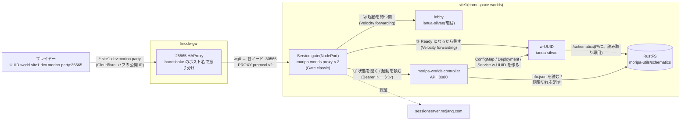

プレイヤーが MoripaUtils で上げた schematic(Sponge v3)を、そのまま 1 つのワールドとして遊べるようにする。
Minecraft のサーバー追加に **`<uuidv7>.world.site1.dev.morino.party`** を入れるだけで、
ログインするとまず**待合ロビー**に入り、ワールドが起動したら**切断されずにそのままワールドへ移る**。
誰もいなくなればワールドは止まる。

- サーバーリストの ping は状態(停止中 / 起動中 / プレイ可能)を表示するだけで、**ワールドは作らない**
- ワールドを作るのは **Mojang の認証を通ったプレイヤーのログインだけ**(認証の要らない接続で枠を埋められないようにするため)
- 対応バージョンは **Minecraft 26.3(protocol 777)だけ**。ワールド・ロビー(ianua-silvae / Minestom)が
  それしか話せないので、Gate が最初に弾く

`kubernetes/sites/site1/apps/worlds/` を ArgoCD の `worlds` Application(`apps` の配下、sync-wave 2)が同期する。
RustFS 本体・バケット・IAM ユーザーは `rustfs`、PV / PVC `schematics` と namespace `worlds` は `csi-s3` の
Application(どちらも sync-wave 1)が先に用意する([RustFS](/docs/admin/rustfs))。

| コンポーネント | 置き場所 | 役割 |
|---|---|---|
| HAProxy(ハブ) | `ansible/group_vars/all/network.yml` の `minecraft_hosts_public` | `:25565` の handshake に `.world.site1.dev.morino.party` が含まれていれば、site1 の全ノードの NodePort `30565` へ PROXY protocol v2 付きで送る |
| `gate`(Deployment 2 台、Service `gate` NodePort `30565`) | `worlds/gate.yaml` | `moripa-worlds proxy`。Minekube Gate(v0.74.32)を組み込んだ classic モードのプロキシ。認証・バージョン確認・ロビーでの待合・ワールドへの移動・MOTD。Kubernetes の権限も S3 のキーも持たない |
| `moripa-worlds`(Deployment 1 台) | `worlds/moripa-worlds.yaml`(コードは github.com/morinoparty/moripa-worlds) | `moripa-worlds controller`。Gate 向けの HTTP API(状態・起動)、片付け係(reaper)、期限切れ schematic の削除(sweeper)。`/metrics` は ServiceMonitor で Prometheus へ |
| `lobby`(Deployment 1 台、Service `lobby`) | `worlds/lobby.yaml` | 待合ロビー。常駐の ianua-silvae で、足場(11×11 の床)を貼っただけのもの。ArgoCD が管理する |
| `w-<uuid>`(ConfigMap / Deployment / Service) | git には無い。moripa-worlds が作って消す | ワールド本体。[ianua-silvae](https://github.com/morinoparty/ianua-silvae)(Minestom)が schematic を貼って待ち受ける |
| RustFS(S3)のバケット `moripa-utils` | `schematics/<uuid>/` | MoripaUtils が上げる本体(`info.json` の `file_name`)と `info.json` |
| PVC `schematics` | `infrastructure/csi-s3/schematics.yaml`(`csi-s3` Application) | csi-s3(geesefs)で `moripa-utils/schematics` を読み取り専用でワールドの Pod に見せる |
| NetworkPolicy | `worlds/networkpolicy.yaml` | Gate の egress、ワールド・ロビー・コントローラの ingress を絞る(後述) |

`gate` と `moripa-worlds` は同じイメージ `ghcr.io/morinoparty/moripa-worlds` の別のサブコマンド(`proxy` / `controller`)。

## 経路



ログインの流れ(Gate の中):

1. **ホスト名**を小文字にし、Forge の `\0FML…` と末尾の `.` を落として `<uuidv7>.world.site1.dev.morino.party` の形か確かめる。
   違えば「このアドレスでは接続できません」
2. **Mojang の認証**(`onlineMode: true`)。ここまでは何も作らない
3. **バージョン**が 26.3(protocol 777)でなければ「Minecraft 26.3 で接続してください」
4. コントローラに `GET /v1/worlds/<uuid>` を聞く
   - 見つからない(`info.json` が無い・壊れている・`delete_at` を過ぎた) → 「ワールドが見つかりません」
   - `ready` → `w-<uuid>` へ直接入れる
   - それ以外 → `POST /v1/worlds/<uuid>/ensure`。`full` / `rate_limited` なら「現在混み合っています」、
     `error` なら「ワールドを起動できませんでした」。`created` / `existing` なら **ロビー**へ入れる
5. ロビーにいる間、Gate はワールドの状態を 1 秒ごとに聞き(同じワールドを待つ人が何人いても 1 本にまとめる)、
   アクションバーに「「タイトル」を起動しています… N秒」を出す。Ready になったら `w-<uuid>` へ移す
   (失敗したら 3 回まで再試行)。`STARTUP_WAIT`(5 分、コントローラの `STARTUP_TIMEOUT` と同じ)を過ぎたら切断する
6. ワールドから蹴られた(クラッシュ・reaper による停止など)ときは、ban / whitelist のような意図した kick でなければ
   ロビーへ戻して 5 からやり直す(回数に上限あり)

補足:

- Gate → ロビー / ワールドは **Velocity modern forwarding**。ロビーとワールドは秘密(Secret `worlds-forwarding`)を
  持つ接続しか受けず、自分では認証しない(`IANUA_VELOCITY_SECRET` が入っていると `onlineMode` は無視される)。
  プレイヤーの UUID・名前・スキン・実 IP は forwarding で渡る
- Gate は `servers` にロビーだけを静的に持ち、`w-<uuid>` は Ready を確かめてから実行時に登録する。
  組み込みコマンド(`/server` など)は切ってある(`builtinCommands: false`)。全員が同じ Gate を共有するので、
  残すと他人のワールドへ移れてしまう
- **Gate v0.74.32 の既知の不具合**: classic モードの `connectionTimeout` / `readTimeout` が使う所でもう一度
  `time.Millisecond` 倍される(既定の `5s` / `30s` は桁あふれして実質無期限)。`gate-config` では **ナノ秒で**
  `connectionTimeout: 5000ns` / `readTimeout: 30000ns` と書き、Gate が倍した後に 5 秒 / 30 秒になるようにしている。
  proxy は実効値が 1 秒〜10 分に収まらない設定(省略・`5s` と書いた等)では起動しない。値を倍さずに使う BungeeCord の
  plugin message(`bungeePluginChannelEnabled`)は切り、同じ理由で必ず出る「backend server has not sent a single packet」の
  誤報ログは proxy が落とす
- ハブの HAProxy は handshake の hex を部分一致で見る(既存の `minecraft_hosts` と同じ仕組み)。
  ワールドのサフィックスは公開してよいので sops の対応表ではなく `network.yml` の
  `minecraft_hosts_public` に平文で置き、`tcp_routes` の `minecraft` で sops の表より先に連結している

### サーバーリストの表示

ping は Gate が答える(ワールドにもロビーにも繋がない)。状態はワールドごとに 5 秒キャッシュする。

| 状態 | MOTD |
|---|---|
| 見つかった・Ready | `<タイトル>` / `プレイ可能` |
| 見つかった・起動中 | `<タイトル>` / `起動中…` |
| 見つかった・止まっている | `<タイトル>` / `参加すると起動します` |
| 見つからない | `ワールドが見つかりません` |
| ホスト名の形が違う | `このアドレスでは接続できません` |

バージョン欄は常に `26.3`(protocol 777)なので、他のバージョンのクライアントには「サーバーが古い / 新しい」と出る。

## コントローラの API

`moripa-worlds` の `:8080`(`/healthz`・`/readyz`・`/metrics` と同じポート)。`/v1/*` は
`Authorization: Bearer <token>`(Secret `moripa-worlds-api` の `token`)が要る。`<id>` は小文字の UUIDv7。

| メソッド / パス | 返すもの |
|---|---|
| `GET /v1/worlds/<id>` | `{"id", "found", "title", "state": "absent" \| "starting" \| "ready", "address": "w-<id>.worlds.svc.cluster.local:25565"}`。`ready` は Deployment が Available かつ status ping に答えること |
| `POST /v1/worlds/<id>/ensure` | 上と同じ + `"result": "created" \| "existing" \| "full" \| "rate_limited" \| "not_found" \| "error"` |

同時起動数(`MAX_WORLDS`)と作成のレート制限はコントローラだけが持つ(Gate が 2 台でも数がずれない)。

```bash
kubectl -n worlds port-forward svc/moripa-worlds 8080 &
TOKEN=$(kubectl -n worlds get secret moripa-worlds-api -o jsonpath='{.data.token}' | base64 -d)
curl -s -H "Authorization: Bearer $TOKEN" localhost:8080/v1/worlds/<uuid>
```

## 名前と DNS

- 形式は `<uuidv7>.world.site1.dev.morino.party`。`<uuidv7>` は MoripaUtils が付ける schematic の ID
  (小文字、RFC 9562 の version 7)。それ以外の形は Gate が「このアドレスでは接続できません」で返す
- **DNS の追加は不要**。既存のワイルドカード `*.site1.dev.morino.party`(ハブの公開 IP)は複数ラベルにも
  一致する(`<uuid>.world.site1.dev…` も同じ答え)。ただし `world.site1.dev.morino.party` 自体の
  レコードを作るとワイルドカードが効かなくなるので作らない
- TLS は無い(Minecraft の TCP)ので証明書の 1 ラベル制約は関係ない

## ライフサイクル

| きっかけ | 動き |
|---|---|
| サーバーリストの ping | Gate が API で状態を聞いて MOTD を返す。**ワールドは作らない** |
| ログイン(ワールドが無い) | 認証・バージョン確認の後、Gate が ensure を呼び、コントローラが `info.json` を確かめて `w-<uuid>` を作る。プレイヤーはロビーで待つ |
| 同時起動数が `MAX_WORLDS`(6)に達している / 作成のレート制限 | 「現在混み合っています」で切断する(作らない)。ロビーは数えない |
| ID が不正 / `info.json` が無い / `delete_at` を過ぎた | 「ワールドが見つかりません」 |
| 起動して Ready になった | ロビーで待っていたプレイヤーを Gate が移す。以後のログインはロビーを通らず直接入る |
| `STARTUP_TIMEOUT`(5 分)経っても Ready にならない | reaper が `w-<uuid>` を消す(イメージの pull と schematic 待ちの init コンテナ最大 120 秒を含めて収まる長さ)。ロビーで待っていたプレイヤーは Gate の `STARTUP_WAIT` で切断される |
| 起動後、一度も参加されないまま `UNJOINED_TIMEOUT`(3 分)経った | reaper が消す(reason `unjoined`)。一度でも人が入ると annotation `worlds.morino.party/played=true` が付き、以後は `IDLE_TIMEOUT` で判定する |
| 無人(status ping の `players.online` が 0)が `IDLE_TIMEOUT`(10 分)続いた | reaper が消す。数えるのはワールドにいる人だけ(ロビーで待っている人は数えない)。最後に人がいた時刻は Deployment の annotation `worlds.morino.party/last-active` に残すので、moripa-worlds が再起動しても数え直さない |
| ワールドが落ちた / 消された(プレイ中) | Gate がプレイヤーをロビーへ戻し、起動し直して待たせる(回数に上限あり) |
| `info.json` が消えた / `delete_at` を過ぎた | reaper が消す |
| `delete_at` を過ぎた schematic | sweeper(`SWEEP_INTERVAL` = 1 時間ごと)が RustFS の `schematics/<uuid>/` を丸ごと消す(MoripaUtils 自身は消さない) |

ワールドの Pod は init コンテナ(busybox)が `/schematics/<uuid>/<file_name>` が見えるまで最大 120 秒待つ
(geesefs は一覧を 10 秒ほどキャッシュするので、上げた直後は見えないことがある)。
ワールドもロビーもディスクに何も書かない(読み取り専用の schematic を貼るだけ)ので、消しても失うものは無い。

### 配置と起動の速さ

- ワールドの Pod は CPU request `WORLD_CPU_REQUEST`(200m、limit 無し)、メモリ request 384Mi / limit 768Mi。
  実測の使用量は 1 つ 190〜220MiB(ロビーは約 180MiB)
- Pod には `topologySpreadConstraints`(`kubernetes.io/hostname`、`ScheduleAnyway`)を付けてノードに散らす。
  付けないとスケジューラーはイメージを持つノードを好むので、最初に起動したノードに偏る
- DaemonSet `world-image-prepull`(`prepull.yaml`)が ianua-silvae と busybox のイメージを全ノードに取っておく。
  ワールドのイメージはダイジェスト固定なので `IfNotPresent` になり、起動のたびに ghcr.io へ問い合わせない
  (`:main` のままだと毎回 `Always` で、遅いときは取得だけで 10 秒以上かかっていた)
- ianua-silvae のイメージは `kustomization.yaml` の `images` だけで固定する。lobby と prepull はそこから、
  moripa-worlds の `WORLD_IMAGE` は `replacements` で lobby の値をコピーするので、3 か所は常に同じになる

## ロビー

- `lobby.yaml` の ConfigMap `lobby-config` に `config.json` と足場の schematic(`binaryData.lobby.schem`、300 バイト弱)を入れ、
  それぞれ `/server/config/config.json` と `/lobby/lobby.schem` にマウントする。足場は `scripts/make_lobby_schem.py` で作る
  (11×1×11 の石レンガの床とシーランタン。(0, 64, 0) に貼ってスポーンは中央 (5.5, 65, 5.5)、奈落は床の 16 下)
  ```bash
  python3 scripts/make_lobby_schem.py /tmp/lobby.schem && base64 -w0 /tmp/lobby.schem
  ```
- ArgoCD が管理し、moripa-worlds は触らない。`app.kubernetes.io/managed-by=moripa-worlds` を付けると reaper に消されるので付けない
  (ラベルは `app.kubernetes.io/name=lobby`・`app.kubernetes.io/component=lobby`)
- `lobby-config` は起動時に読むだけ。変えたら `lobby.yaml` の `worlds.morino.party/lobby-config-rev` を上げて push する

## セキュリティ

- **namespace は Pod Security restricted**: moripa-worlds(コントローラ)は S3 の JSON を読み、かつ namespace 内の
  Deployment を作れる(名前が動的なので Role を `resourceNames` で絞れない)。乗っ取られても privileged / hostPath /
  hostNetwork の Pod でノードへ抜けられないよう、namespace `worlds`(`infrastructure/csi-s3/namespace-worlds.yaml`)に
  `pod-security.kubernetes.io/enforce: restricted` を付けている。デバッグで `kubectl run` するときも `runAsNonRoot`・
  seccomp `RuntimeDefault`・`drop: [ALL]`・`allowPrivilegeEscalation: false` が要る
  (例は [RustFS の反映後の確認](/docs/admin/rustfs#反映後の確認))
- **インターネットに面するのは権限の無い Gate だけ**: Gate は ServiceAccount のトークンを持たず
  (`automountServiceAccountToken: false`)、S3 のキーも持たない。コントローラとは Bearer トークン付きの API だけで話す
- **ワールドを作れるのは認証済みのプレイヤーだけ**: ensure は Mojang の認証とバージョン確認の後にしか呼ばない。
  さらにコントローラ側で同時起動数と作成のレート(全体でトークンバケット)を絞る
- **PROXY protocol は「信頼する送信元ならヘッダ任意」**: Gate は private アドレスからの接続のヘッダを信じ、
  ヘッダ無しも通す。NodePort `30565` は拠点 LAN から直接も届く(Cilium の eBPF が INPUT より前に
  転送するので、`ingress_filter_extra_ports` の nft では止まらない)が、入れるのはハブ経由と同じ
  ワールドに同じ認証でだけ。送信元 IP を偽れるのは Gate のログ・接続数制限(`quota`)に対してだけ
- **forwarding の秘密が漏れると認証を飛ばせる**: ワールド・ロビーへ直接繋げる相手(クラスタ内)が秘密を知っていれば、
  任意の UUID / 名前で入れる。届く相手は NetworkPolicy で Gate とコントローラに絞ってある
- **RustFS のキー**: `moripa-worlds-s3` は `moripa-utils/schematics/*` の Get / Delete とバケットの List だけを許したユーザーのもの
- **ArgoCD は `w-<uuid>` を触らない**: 追跡用の annotation / label(`argocd.argoproj.io/tracking-id`、
  `app.kubernetes.io/instance`)を付けないので prune の対象にならない。moripa-worlds が付けるのは
  `app.kubernetes.io/managed-by=moripa-worlds` と `worlds.morino.party/id=<uuid>`

### NetworkPolicy

`networkpolicy.yaml`。Cilium は ClusterIP を Pod に変換してから判定するので Pod のポートで書く。
kubelet の probe(ホストから)は Cilium の既定(`allow-localhost=auto`)で policy に関係なく通る。

| 対象 | ingress | egress |
|---|---|---|
| `gate` | 絞らない(NodePort で外から受ける) | DNS、`moripa-worlds` の `:8080`、ワールド・ロビーの `:25565`、インターネット(private / 特殊用途を除く)の TCP `443`(Mojang の session server) |
| ワールド(`component=world`) | `gate` と `moripa-worlds`(status ping)からの `:25565` | DNS とインターネット(private / 特殊用途を除く)。クラスタ内・拠点内へは出られない |
| `lobby`(`component=lobby`) | ワールドと同じ | 絞らない |
| `moripa-worlds` | `gate` と namespace `monitoring`(Prometheus)からの `:8080` | 絞らない(k8s API・RustFS・ワールドへの ping) |

## 秘密(`secrets.sops.yaml`)

| Secret / キー | 使うもの | 中身 |
|---|---|---|
| `moripa-worlds-s3` / `AWS_ACCESS_KEY_ID`・`AWS_SECRET_ACCESS_KEY` | `moripa-worlds` | RustFS のユーザー `worlds`(上記の権限だけ)。`AWS_SECRET_ACCESS_KEY` は `infrastructure/rustfs/secrets.sops.yaml` の `WORLDS_SK` と同じ値にする(RustFS への登録は `rustfs-provision` Job が行う) |
| `worlds-forwarding` / `secret` | `gate`(`FORWARDING_SECRET`)、`lobby` と各 `w-<uuid>`(`IANUA_VELOCITY_SECRET`) | Velocity modern forwarding の秘密(英数字 48 文字)。ワールドへはコントローラが `FORWARDING_SECRET_NAME` の Secret を `secretKeyRef` で渡す(コントローラ自身は値を読まない) |
| `moripa-worlds-api` / `token` | `gate` と `moripa-worlds`(どちらも `API_TOKEN`) | コントローラの API の Bearer トークン(英数字 40 文字) |

```sh
SOPS_AGE_KEY_FILE=~/keys/age-admin.agekey sops kubernetes/sites/site1/apps/worlds/secrets.sops.yaml
```

ArgoCD は Secret の変更で Pod を作り直さない。変えたら使っている Deployment を作り直す。
`worlds-forwarding` を変えたときは、動いているワールドが古い値のままになるので消す(次のログインで作り直される)。

```bash
kubectl -n worlds rollout restart deploy/gate deploy/moripa-worlds deploy/lobby
kubectl -n worlds delete deploy,svc,cm -l app.kubernetes.io/managed-by=moripa-worlds   # forwarding を変えたとき
```

## 導入の順番

初めて入れるとき:

1. **ianua-silvae**: `ghcr.io/morinoparty/ianua-silvae` は public。ロビーとワールドは 26.3 版の `main` を
   `kustomization.yaml` の `images` でダイジェスト固定して使う(`WORLD_IMAGE` には `replacements` で同じ値が入る)
2. **moripa-worlds**: `ghcr.io/morinoparty/moripa-worlds` は public。`gate.yaml` と `moripa-worlds.yaml` は
   同じ `sha-<short>@sha256:...` で固定する
3. **infra を push**: ArgoCD がまず sync-wave 1 の `rustfs`(RustFS 本体。PostSync の Job `rustfs-provision` が
   バケット `moripa-utils` と IAM ユーザー `moripa-utils`・`worlds`・`csi-s3` / ポリシーを入れる)と
   `csi-s3`(ドライバ・namespace `worlds`・PV / PVC `schematics`)を、続いて wave 2 の `apps` 配下の `worlds`
   (Gate・moripa-worlds・ロビー・NetworkPolicy・Secret)を同期する
4. **同期の確認**(詳しくは [RustFS の反映後の確認](/docs/admin/rustfs#反映後の確認))
   ```bash
   kubectl -n rustfs get deploy,pod,pvc        # RustFS が Ready
   kubectl -n worlds get pvc schematics        # STATUS Bound
   kubectl -n worlds get deploy gate moripa-worlds lobby   # すべて Ready
   ```
5. **ハブの HAProxy**: `make gateway`(`tcp_proxy` ロールが `haproxy.cfg` を書き換えて reload する)。
   Firewall・Terraform・DNS の変更は不要

### 旧構成(Gate Lite + waker)からの切り替え

Gate の Service(NodePort `30565`)とハブの HAProxy はそのまま使えるので、ハブ側の作業は無い。

1. **moripa-worlds** の `proxy` / `controller` を含むイメージを publish し、`kustomization.yaml` の `images` の
   タグ・ダイジェストを上げる(`gate.yaml` と `moripa-worlds.yaml` は両方ここで固定される)。
   旧イメージ(118169c)は `controller` / `proxy` を知らないので、上げる前に push すると Gate もコントローラも
   起動せず、どのワールドにも入れなくなる
2. **infra を push**: `worlds` Application が Secret 2 つ・ロビー・新しい Gate・コントローラ・NetworkPolicy を同期する。
   Gate が入れ替わる間(数十秒)は接続できない
3. **旧ワールドを消す**: 旧構成で作られた `w-<uuid>` は forwarding の秘密を持たず、自分で認証する設定のまま。
   新しい Gate からは繋がらないので、すべて消す(次のログインで新しい設定で作り直される)
   ```bash
   kubectl -n worlds delete deploy,svc,cm -l app.kubernetes.io/managed-by=moripa-worlds
   ```
4. 26.3 のクライアントで `<uuid>.world.site1.dev.morino.party` に入り、ロビー → ワールドへ移ることを確かめる

Gate の設定(`gate-config`)は起動時に読むだけ(`noAutoReload: true`。forwarding の秘密は起動時にメモリ上で
差し込むので、ファイルの読み直しをさせると秘密の無い設定が当たる)。変えたら `gate.yaml` の `worlds.morino.party/gate-config-rev` を
上げて push する(Pod が作り直される)。

## 確認とトラブルシューティング

```bash
# 全体
kubectl -n worlds get deploy,svc,pod -o wide
kubectl -n worlds get deploy -l app.kubernetes.io/managed-by=moripa-worlds \
  -L worlds.morino.party/id

# 入口(認証・待合・移動のログ)
kubectl -n worlds logs deploy/gate --tail=50
# API / reaper / sweeper(JSON ログ)
kubectl -n worlds logs deploy/moripa-worlds --tail=100
# ロビー
kubectl -n worlds logs deploy/lobby --tail=50

# 個別のワールド
U=<uuid>
kubectl -n worlds describe deploy w-$U
kubectl -n worlds logs deploy/w-$U --all-containers --prefix   # init コンテナ(schematic 待ち)も
kubectl -n worlds get cm w-$U -o jsonpath='{.data.config\.json}'

# 手で止める(次のログインでまた起動する)
kubectl -n worlds delete deploy,svc,cm -l worlds.morino.party/id=$U

# メトリクス(コントローラ: worlds_running / worlds_reaped_total など、Gate: players_waiting / world_connects_total)
kubectl -n worlds port-forward svc/moripa-worlds 8080 &
curl -s localhost:8080/metrics | grep -E '^(worlds|schematics|api)_'
curl -s localhost:8080/readyz
kubectl -n worlds port-forward deploy/gate 8081:8080 &
curl -s localhost:8081/metrics | grep -E '^(players_waiting|world_connects_total)'

# ハブ側(25565 の振り分けと、各ノード :30565 のヘルスチェック)
ssh gw.wg.morino.party 'echo "show servers state minecraft__world_site1_dev_morino_party" | sudo nc -U /run/haproxy/admin.sock'
```

| 症状 | 見るところ |
|---|---|
| サーバーリストで「接続できません」(MOTD も出ない) | ハブの HAProxy(backend `minecraft__world_site1_dev_morino_party` が UP か)→ `gate` の Pod / NodePort |
| 「Minecraft 26.3 で接続してください」 | クライアントのバージョン。26.3 以外は入れない |
| 「ワールドが見つかりません」 | ID の形(小文字の UUIDv7)、RustFS に `schematics/<uuid>/info.json` があるか、`delete_at` |
| ログインで認証エラー | Gate から `sessionserver.mojang.com` へ出られるか(NetworkPolicy `gate-egress` の 443、DNS) |
| MOTD が出ない / いつも「見つかりません」 | Gate → コントローラの API。`moripa-worlds` が Ready か、`moripa-worlds-api` のトークンが両方で同じか(401 は Gate のログに出る) |
| ロビーで「起動しています」のまま進まない | `w-<uuid>` の Pod。init コンテナが schematic を待っている(PVC `schematics` / csi-s3)、イメージが pull できない、メモリ不足 |
| ワールドへ移るところで切れる / 「起動できませんでした」 | ワールドの forwarding の秘密(`w-<uuid>` の Pod に `IANUA_VELOCITY_SECRET` があるか。旧構成の残りなら消す)、`worlds-forwarding` を変えた後に Pod を作り直したか |
| ロビーに入れない | `lobby` の Pod と、`lobby` に `IANUA_VELOCITY_SECRET` が入っているか |
| 「現在混み合っています」 | `MAX_WORLDS` に達しているか、作成のレート制限。参加されないワールドは `UNJOINED_TIMEOUT`、無人のワールドは `IDLE_TIMEOUT` で消える |
